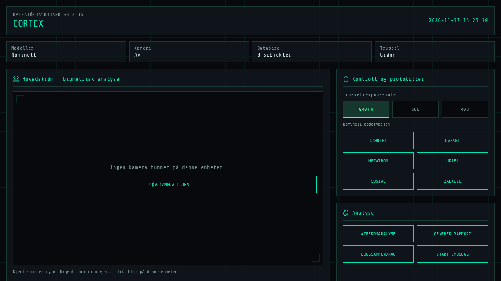
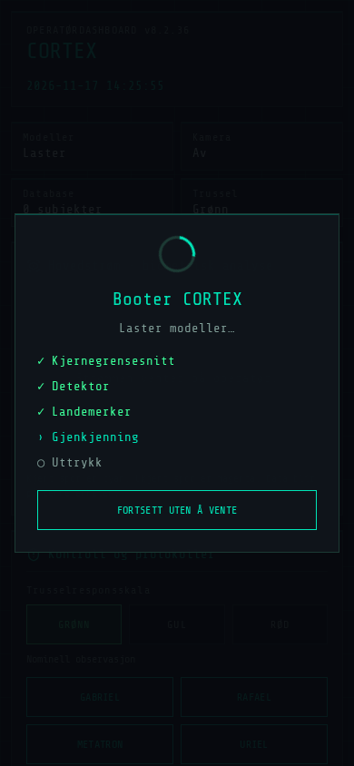

# CORTEX operatørdashboard

Biometrisk operatørflate med **lokal ansiktsdatabase**, trusselnivå, operative mål og valgfri KI-analyse.

Alt biometrisk og operativt innhold kjører lokalt i nettleseren. KI er helt frivillig og krever at du selv limer inn en API-nøkkel.

## Skjermbilder

Hovedskjerm med kamera, trusselskala og protokoller.



Oppstart mens ansiktsmodellene lastes.


Mål, database og systemlogg.


Samme flate på smal skjerm.



## Funksjoner

- **Lokal ansiktsgjenkjenning** – bruker face-api.js. Ingen bilder eller beskrivelser sendes til noen server.
- **Ansiktsdatabase** – lagre, navngi og slette subjekter direkte i nettleseren.
- **Trusselnivå** – Grønn / Gul / Rød med tilhørende hint.
- **Operative mål** – opprett og kryss av mål (Zadkiel-protokoll).
- **Systemlogg** – tidsstemplet logg over deteksjoner, hendelser og handlinger.
- **Valgfri KI-analyse** – Grok (xAI) eller Gemini. Nøkkelen lagres bare lokalt.
- **Protokoller**:
  - **Gabriel** – systemintegritet (modeller, kamera, antall subjekter, status)
  - **Zadkiel** – operative mål og trusselstatus
  - **Rafael, Metatron, Uriel, Sandalphon** – KI-baserte analyser (krever nøkkel + kamerabilde)
  - Atferdsanalyse, skiftrapport og loggsammendrag
- **Kamerastyring** – start/stopp, bytt kamera, overlay med bokser og etiketter.
- **Toleransejustering** – styr hvor streng gjenkjenningen er.
- **Eksport** – last ned databasen som JSON.

## Kom i gang

```bash
npm install
npm run dev
```

Åpne nettleseren på `http://localhost:8080`.

### Første gangs bruk

1. Vent til modellene er lastet (boot-skjerm).
2. Aktiver dashboardet og gi kameratilgang.
3. Fang et ansikt og lagre det med navn for å bygge databasen.
4. (Valgfritt) Gå til Analyse, lim inn API-nøkkel for Grok eller Gemini, og valider.

## Bruk

### Ansiktsdatabase
- Trykk **Fang** mens et ansikt er synlig for å lagre det.
- Ukjente ansikter som dukker opp kan også lagres i etterkant.
- Alle beskrivelser (descriptors) lagres lokalt i `localStorage`.

### Trusselnivå og mål
- Sett trusselnivå manuelt.
- Legg til operative mål. Zadkiel-protokollen viser status og mål.

### KI-analyse
KI er **av** som standard.

1. Velg leverandør: **Grok (xAI)** eller **Gemini (Google)**.
2. Lim inn API-nøkkel.
3. Trykk **Valider**.

Nøkkelen lagres bare i nettleseren og sendes aldri med i git eller til andre enn den valgte leverandøren.

Protokollene som bruker KI (Rafael, Metatron osv.) krever både gyldig nøkkel og et aktivt kamerabilde.

### Protokoller uten KI
- **Gabriel** – sjekker at modeller, kamera og database er i orden.
- **Zadkiel** – viser trussel og operative mål.

## Personvern

- Ansiktsdata, logg, mål og trusselnivå lagres **kun** i nettleserens `localStorage`.
- Ingen biometriske data sendes til noen server.
- API-nøkler lagres også lokalt og brukes bare når du aktivt kjører en KI-protokoll.
- Du kan eksportere eller slette databasen når som helst.

## Dokumentasjon

- [API-dokumentasjon](docs/API.md) – server-funksjoner, lokal lagring og visjons-API
- [Lisens](LICENSE)

## Utvikling

| Kommando              | Beskrivelse                          |
|-----------------------|--------------------------------------|
| `npm run dev`         | Start utviklingsserver (port 8080)  |
| `npm run build`       | Produksjonsbygg + migrering         |
| `npm run typecheck`   | TypeScript-sjekk                    |
| `npm test`            | Kjør tester                          |
| `npm run lint`        | ESLint                              |
| `npm run format`      | Prettier                            |

### Teknisk stack
- **Frontend**: React 19, TanStack Router / Start, Tailwind CSS 4, Radix UI
- **Biometri**: face-api.js (lokal)
- **Tilstand**: Zustand + localStorage
- **KI**: Valgfritt via Grok (xAI) eller Gemini
- **Bygg**: Vite

## Lisens

Dette prosjektet er lisensiert under [MIT License](LICENSE).

Copyright (c) 2026 Jon-Arve Constantine Grønsberg-Ovesen (GizzZmo)
