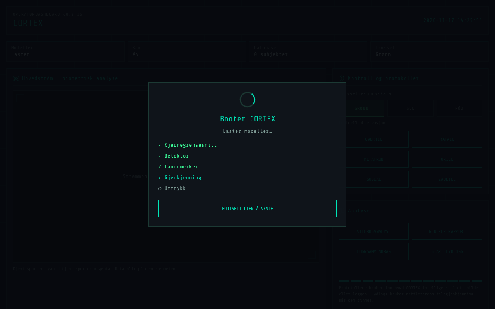

# CORTEX operatørdashboard

Biometrisk operatørflate med lokal ansiktsdatabase, trusselnivå og valgfri KI.

KI er av til du selv limer inn en nøkkel under **Analyse**, velger **Grok (xAI)** eller **Gemini (Google)**, og trykker **Valider**. Nøkkelen lagres bare i nettleseren og sendes ikke med i git.

Gabriel, Zadkiel, lydlogg og ansiktsdatabasen virker uten nøkkel.

## Skjermbilder

Hovedskjerm med kamera, trusselskala og protokoller.


Oppstart mens ansiktsmodellene lastes.



Mål, database og systemlogg.


Samme flate på smal skjerm.


```bash
npm install
npm run dev
```
