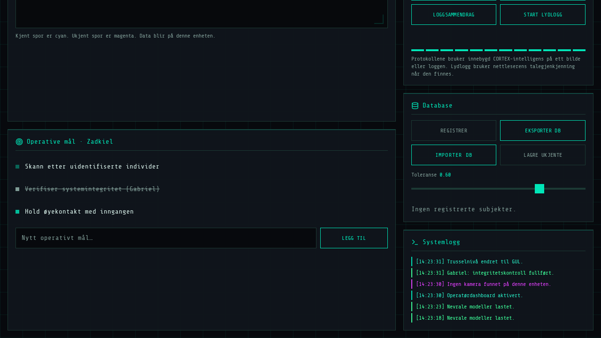

# CORTEX operatørdashboard

Biometrisk operatørflate med **lokal ansiktsdatabase**, trusselnivå, operative mål og valgfri KI-analyse.

Alt biometrisk og operativt innhold kjører lokalt i nettleseren. KI er helt frivillig og krever at du selv limer inn en API-nøkkel.

## Skjermbilder





## Kom i gang

```bash
npm install
npm run dev
```

Åpne `http://localhost:8080`.

## Dokumentasjon

All detaljert dokumentasjon ligger under [`/docs`](docs/README.md):

- [Brukerveiledning](docs/brukerveiledning.md)
- [Protokoller](docs/protokoller.md)
- [API](docs/API.md)
- [Arkitektur](docs/arkitektur.md)
- [Personvern og sikkerhet](docs/personvern.md)
- [Utvikling](docs/utvikling.md)

## Kort oversikt

- Lokal ansiktsgjenkjenning (face-api.js)
- Trusselnivå (Grønn / Gul / Rød)
- Operative mål og systemlogg
- Protokoller: Gabriel, Zadkiel + KI-baserte (Rafael, Metatron, Uriel, Sandalphon m.fl.)
- Valgfri KI via Grok eller Gemini
- All data i localStorage

## Lisens

[MIT License](LICENSE)

Copyright (c) 2026 Jon-Arve Constantine Grønsberg-Ovesen (GizzZmo)
